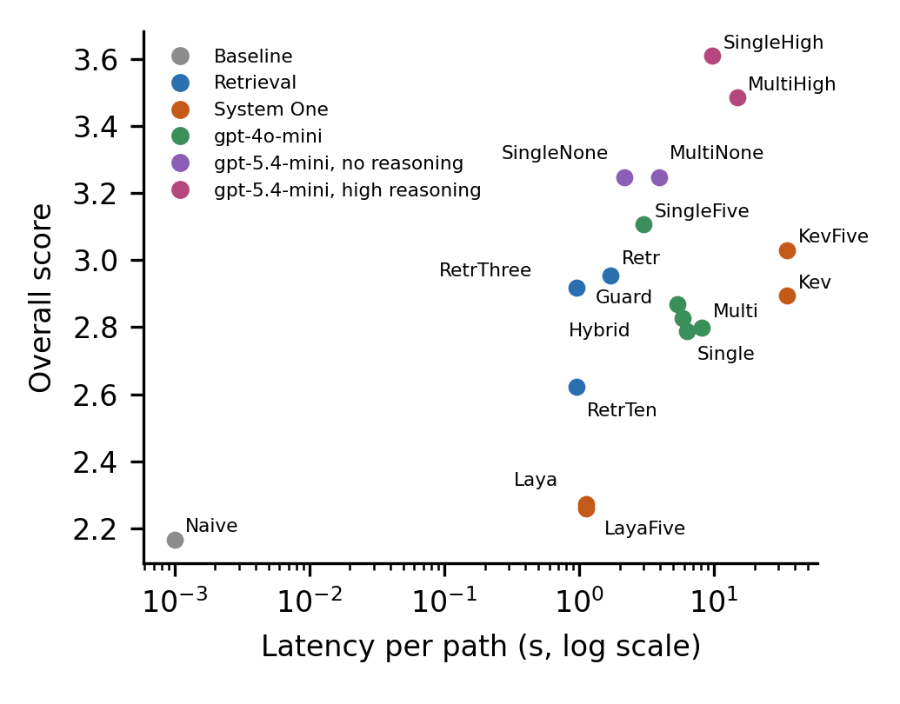

# PlaforEdu Learning-Path Curation

Code and data for the paper *Fast, Slow, or Agentic? System One Decision Models,
Reasoning LLMs, and Self-Reflective Multi-Agent Curation of Learning Paths for
Public-Sector Training* (`papers/ieee-access/access.tex`).

It compares LLM agents (single agent, multi-agent critic loop, hybrid), embedding
retrieval and System One decision models (Kev, Laya, Jev) for curating ordered
learning paths (*trilhas formativas*) on the PlaforEdu platform.

## Results
66 competencies, 17 configurations, 2574 paths. Overall is the 1 to 5 score of the
primary judge (claude-opus-5-5, every path), averaged over runs per competency, with
bootstrap 95% CI. Two judges is the mean of claude-opus-5-5 and gpt-4o on run 0.

| Family | System | Overall [95% CI] | Two judges | Length | Invalid IDs | Cost/path (USD) |
|---|---|---|---|---|---|---|
| Baseline | Naive (all candidates) | 2.17 [2.00, 2.33] | 2.68 | 15.0 | 0.0% | 0 |
| Retrieval | k=3 | 2.92 [2.73, 3.11] | 3.45 | 2.9 | 0.0% | 0 |
| | k=5 | 2.95 [2.77, 3.14] | 3.44 | 4.6 | 0.0% | 0 |
| | k=10 | 2.62 [2.47, 2.76] | 3.08 | 8.0 | 0.0% | 0 |
| System One | Laya, top 5 | 2.26 [2.09, 2.42] | 2.76 | 4.6 | 0.0% | 0 (local) |
| | Kev-4B, threshold | 2.89 [2.70, 3.09] | 3.29 | 8.8 | 0.0% | 0 (local) |
| | Kev-4B, top 5 | 3.03 [2.82, 3.26] | 3.52 | 4.6 | 0.0% | 0 (local) |
| gpt-4o-mini | Single agent | 2.79 [2.62, 2.95] | 3.18 | 7.7 | 0.5% | 0.0006 |
| | Single agent, max 5 | 3.11 [2.91, 3.29] | 3.64 | 4.6 | 0.5% | 0.0005 |
| | Multi-agent critic loop | 2.80 [2.64, 2.96] | 3.23 | 7.6 | 3.3% | 0.0009 |
| | Multi-agent, guarded | 2.83 [2.66, 2.99] | 3.25 | 7.5 | 0.0% | 0.0009 |
| | Hybrid retrieve, generate, verify | 2.87 [2.69, 3.05] | 3.30 | 7.1 | 0.0% | 0.0005 |
| gpt-5.4-mini, no reasoning | Single agent | 3.25 [3.09, 3.40] | 3.57 | 5.9 | 0.9% | 0.0037 |
| | Multi-agent critic loop | 3.25 [3.07, 3.41] | 3.57 | 6.0 | 0.7% | 0.0054 |
| gpt-5.4-mini, high reasoning | **Single agent** | **3.61 [3.43, 3.78]** | 3.90 | 5.2 | 0.4% | 0.0141 |
| | Multi-agent critic loop | 3.48 [3.30, 3.66] | 3.85 | 5.4 | 0.8% | 0.0203 |

Main findings:
- Reasoning helps most (confirmed by both judges): high reasoning beats no reasoning by +0.36 (p < 0.001).
- The critic loop adds cost but no quality, with or without reasoning.
- Capping the path at 5 courses gives +0.32; much of the judged quality is concision.
- The ID gate (guarded and hybrid systems) removes every invalid course ID; only the
  unguarded gpt-4o-mini critic loop fabricated courses.
- Kev-4B with top 5 matches embedding retrieval at zero API cost; Laya is no better
  than the naive baseline.



## Layout
- `src/db.py`: SQLite access to the course and competency catalog.
- `src/systems.py`: all curation systems.
- `src/run.py`: path generation, written to `results/gen_v2.jsonl`.
- `src/rejudge.py`: LLM judges, written to `results/judgments_v2.jsonl`.
- `src/analyze_v2.py`: tables, figures and LaTeX macros for the paper.
- `src/make_human_eval.py`: blind workbook for human curators.
- `src/judge.py`, `src/analyze.py`: preliminary (v1) study.
- `papers/ieee-access/`: manuscript.

## Reproduce
```bash
pip install -r requirements.txt
export OPENAI_API_KEY=... ANTHROPIC_API_KEY=...

# System One servers on a local GPU
#   Laya: pip install "laya[serve]"; LAYA_MODELS=multilingual laya-serve           (port 8000)
#   Kev:  git clone https://github.com/jaredpalmer/kev; uv sync --extra serve
#         uv run python -m kev.serve --run jaredpalmer/kev-4b@v1.0 --port 8009
#   Jev:  export TYPESAFE_API_KEY=...

python src/run.py --seed-from-v1
python src/run.py --systems single_agent multi_agent single_agent_max5 multi_agent_guarded hybrid \
                  retrieval_k3 retrieval_k10 --models gpt-4o-mini --runs 3
python src/run.py --systems single_agent multi_agent --models gpt-5.4-mini:none gpt-5.4-mini:high --runs 3
python src/run.py --systems s1_laya s1_kev4b && python src/run.py --derive-s1-top5
python src/rejudge.py --judges gpt-4o claude-opus-5-5
python src/analyze.py && python src/analyze_v2.py
```
